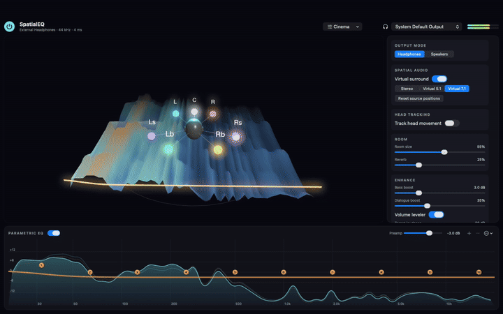
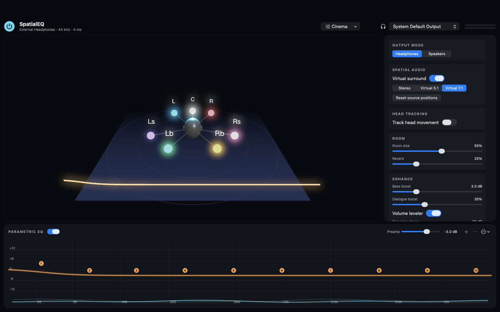
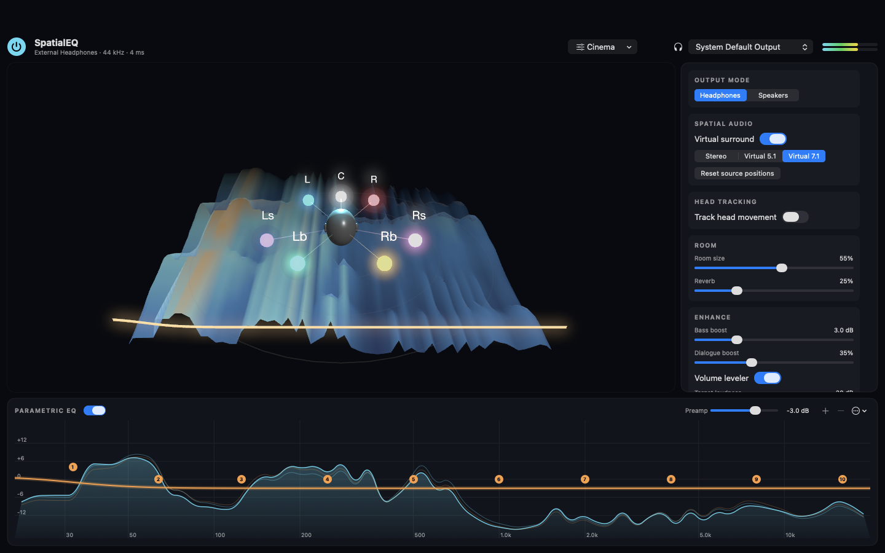

# SpatialEQ

[](https://github.com/Kiptoo-Deus/SpatialEQ/actions/workflows/ci.yml)

**Parametric EQ and spatial audio with an interactive 3D scene, for macOS, Windows, Android and iOS.**

Developed by [Savannah DSP](https://savannahdsp.com) · v1.1.1



▶ [Full-resolution 360° video (MP4)](docs/spatialeq-360.mp4)

| Idle | Playing |
|---|---|
|  |  |

**Contents:** [Platforms](#platforms) · [Install](#install) · [Features](#features) · [Architecture](#architecture) · [DSP reference](#dsp-reference) · [Build from source](#build-from-source)

---

## Platforms

| Platform | What it processes | How | Status |
|---|---|---|---|
| **macOS** 14.2+ | Every app, to any output device | Core Audio process tap + private aggregate device (no driver) | Released (v1.1.1) |
| **Android** 10+ | Every app that allows audio capture, with per-app switches | `AudioPlaybackCapture` + per-session muting | Released (v1.1.1, APK) |
| **iOS** 17+ | Music files you play inside SpatialEQ | `AVAudioEngine` player | Released as source: build and run with Xcode (not on the App Store yet) |
| **Windows** 10 (2004+) / 11 | Every app, on the device it plays on or any other | WASAPI process loopback + per-app mixer ducking → DSP → WASAPI render (or a virtual cable) | In testing |
| **VST3 plug-in** (macOS, Windows) | The track or bus it's inserted on, in any VST3 host | Stereo insert effect; every control is a host parameter you can automate | In testing (CI builds) |

All platforms share one C++17 DSP core (`DSP/`), so sound and presets are identical everywhere.

---

## Install

### macOS
1. Download **`SpatialEQ-1.1.1.pkg`** (installer) or **`SpatialEQ-1.1.1.dmg`** (drag to Applications) from the [latest release](https://github.com/Kiptoo-Deus/SpatialEQ/releases/latest).
2. Open it. This release isn't notarized by Apple, so macOS blocks it the first time: go to **System Settings → Privacy & Security** and click **Open Anyway**.
3. Launch SpatialEQ and click **Allow** when macOS asks for **System Audio Recording**.

Quitting SpatialEQ returns your Mac's audio to normal immediately. To uninstall, quit it and delete it from Applications.

### Windows
1. Download **`SpatialEQ-windows-x64.zip`** from the [latest release](https://github.com/Kiptoo-Deus/SpatialEQ/releases/latest) (or a CI build), unzip it and run `SpatialEQ.exe`. It is a single portable file; settings live in `%APPDATA%\SpatialEQ`.
2. That's it: the source defaults to **All apps** and the output to your Windows default device, so it works with a single pair of headphones or speakers. Pick another output from the second menu if you like.

How "All apps" works: Windows has no public API that captures other apps' audio *and* silences it (the macOS process tap does both). SpatialEQ captures every app except itself (process loopback, Windows 10 2004+) and, while an app is playing, turns it down to 0.01 % in the Windows volume mixer. The mixer is a floating-point multiply, so SpatialEQ scales the captured sound back up exactly and plays the processed result; what still leaks out directly is 80 dB down. Apps get their volume back as soon as they pause, when SpatialEQ stops or quits, and on sign-out. If SpatialEQ is ever killed mid-playback, it puts the volumes right the next time it runs, and **App → Reset app volumes** does so on demand. While it runs you'll see other apps near zero in the volume mixer; that's expected.

Alternatively, choose a playback device as the source: with a virtual cable such as [VB-CABLE](https://vb-audio.com/Cable/) set as the Windows default output, apps play into the cable and nobody hears them directly, without touching app volumes.

Closing the window keeps SpatialEQ running in the notification area; **Quit** from its tray menu stops it.

### VST3 plug-in
Download **`SpatialEQ-VST3-macOS.zip`** or **`SpatialEQ-VST3-windows-x64.zip`** from a CI build and unzip `SpatialEQ.vst3` into:
- macOS: `~/Library/Audio/Plug-Ins/VST3` (the bundle is ad-hoc signed; if macOS blocks it, run `xattr -dr com.apple.quarantine ~/Library/Audio/Plug-Ins/VST3/SpatialEQ.vst3`).
- Windows: `C:\Program Files\Common Files\VST3`. The editor uses Microsoft Edge WebView2, which Windows 10 and 11 already include.

It has the same interface as the Mac app: the 3D scene, the sidebar and the parametric EQ editor. It also has the same 12 presets and AutoEq import and export. Head rotation is a parameter, so you can automate it in your DAW.

### Android
1. Download **`SpatialEQ-android.apk`** from the [latest release](https://github.com/Kiptoo-Deus/SpatialEQ/releases/latest) on your phone and open it. Allow your browser or file manager to **install unknown apps** when Android asks. Google Play is coming.
   - This APK isn't signed with a permanent release key yet, so a future version may need you to uninstall this one first.
2. Tap **Start** and accept Android's screen-capture prompt. Android routes "capture other apps' audio" through this prompt; SpatialEQ never captures your screen or microphone.
3. **Optional, once:** to let SpatialEQ find every app's audio, run this from a computer with USB debugging on:
   ```bash
   adb shell pm grant com.savannahdsp.spatialeq android.permission.DUMP
   ```

### iOS
SpatialEQ isn't on the App Store yet, so you need a Mac with **Xcode 16** to build and run it on your iPhone:

1. Clone this repository, then run `brew install xcodegen` and `cd ios && xcodegen generate`.
2. Open `ios/SpatialEQ-iOS.xcodeproj`. Under **Signing & Capabilities**, choose your own team (a free Apple ID works).
3. Connect your iPhone, select it as the run destination and press **Run** (⌘R). The first time, trust the developer on the iPhone in **Settings → General → VPN & Device Management**.
4. Import music in **Library → +**, or copy files to SpatialEQ in Finder.

With a free Apple ID, apps installed this way stop opening after 7 days; run them from Xcode again to renew.

---

## Features

### Sound
- **Parametric EQ:** up to 16 bands (peak, low/high shelf, low/high pass), a preamp, and a live response curve over a moving spectrum.
  - **Editing:** drag the handles; on macOS, scroll over a handle to change its Q.
  - **Correction profiles:** import from [AutoEq](https://github.com/jaakkopasanen/AutoEq) / Equalizer APO (`ParametricEQ.txt`) and export your own.
- **Virtual surround (headphones):** binaural rendering of stereo, virtual 5.1 or virtual 7.1. Each virtual speaker can be moved around your head in 3D (⌥-drag on Mac sets height).
- **Head tracking:** AirPods (3rd gen, Pro, Max) and supported Beats on macOS and iOS. Sources stay fixed in the room when you turn your head.
- **Speaker mode:** stereo widening and band-limited crosstalk cancellation, with an adjustable speaker span.
- **Room:** a feedback-delay-network reverb with size and amount.
- **Enhance:** bass boost (shelf plus psychoacoustic harmonics), Dialogue Boost, Volume Leveler, and a look-ahead limiter with an adjustable ceiling.
- **Bypass:** the power button crossfades between processed and original sound without clicks.

### App
- **12 built-in presets:** Flat, Bass Boost, Treble Lift, Loudness, Vocal & Dialogue, Podcast, Cinema, Music Hall, Studio Speakers, Gaming, Wide Speakers, and Laptop Speakers (Phone Speaker on Android). You can also save your own.
- **Per-device memory:** every headphone, speaker and Bluetooth device remembers its own sound. A new device starts in headphone or speaker mode to match its type.
- **3D scene:**
  - What's in it: your head, draggable sources (or speakers), a spectrum "terrain" waterfall and the EQ curve as a glowing ribbon.
  - Controls: orbit, zoom and tilt; double-click or double-tap resets the view.
  - Performance: Metal (SceneKit) on Apple platforms, Canvas on Android.
- **Settings and About:** "Developed by Savannah DSP", with links to [savannahdsp.com](https://savannahdsp.com) and the privacy policy.
- **Windows:**
  - **All apps** capture that works on a single device (no driver or virtual cable), or any playback device / virtual cable as the source. Automatic selection follows devices as they are plugged in or removed.
  - A guard that passes audio through at its normal level whenever an app is not turned down yet (for example one that just started), so nothing is ever boosted by mistake.
  - Notification-area icon with open, on/off and quit; Start with Windows.
  - Native Win32 + Direct3D 11 interface (Dear ImGui) with the same layout as the Mac app; portable single `.exe` with no runtime to install.
- **macOS:**
  - Menu bar panel with on/off, output device, mode and presets.
  - Output picker for any device ("System Default" follows macOS).
  - Launch at login.
- **Android:**
  - **Apps** screen listing every installed app, each with a switch. "Off" means the app is neither captured nor silenced, so it plays untouched.
  - Live "processing / can't be processed" labels.
  - A notification with a Stop button.
  - AdMob banner (Home and Presets screens) with Google's consent form.
- **iOS:**
  - Music library from the Files app or Finder file sharing, with artwork and metadata.
  - Background playback, lock-screen and Control Centre controls.
  - Pauses when headphones are unplugged.

---

## Architecture

```
                 ┌──────────────────────── C++17 DSP core (DSP/) ───────────────────────┐
 capture ──────▶ │ preamp → dialogue → bass → [binaural | width + XTC] → room → EQ       │ ──▶ output
                 │        → leveler → output gain → limiter → bypass crossfade           │
                 └────────────────────────────────────────────────────────────────────────┘
                          ▲ params (lock-free triple buffer)        │ analysis (SPSC ring)
                          │                                         ▼
                        UI thread                         spectrum analyser → 3D scene / EQ view
```

| Platform | Capture | Output |
|---|---|---|
| macOS | Global `CATapDescription` (muted, excludes SpatialEQ) in a private aggregate device whose main sub-device is the chosen output | Aggregate IOProc on the HAL real-time thread → `sq_engine_process_abl` |
| Android | `AudioRecord` + `AudioPlaybackCaptureConfiguration`: media/game/unknown usages, excluding SpatialEQ and switched-off apps | `AudioTrack` (low latency, `ALLOW_CAPTURE_BY_NONE`). Originals are silenced with a `DynamicsProcessing` effect at −200 dB input gain on each captured session. |
| iOS | `AVAudioFile` → `AVAudioConverter` on a decode queue → lock-free FIFO | `AVAudioSourceNode` → engine → mixer |

Android finds sessions by reading the system `audio` service dump. That's why the optional `DUMP` grant is needed: it lists each player's UID, usage, attribute flags and session ID. The `media.audio_policy` dump shows which packages forbid capture. A session is muted only when its app allows capture, so an app can never go silent.

**Real-time rules** (enforced in the core):
- The audio thread never allocates memory, locks or blocks.
- Parameters arrive through a lock-free triple buffer, and coefficients are recomputed once per block.
- Gain and position changes are smoothed per sample.
- Denormals are flushed to zero (FPCR FZ on arm64, MXCSR FTZ|DAZ on x86).
- With every feature on (virtual 7.1 + room + bass + dialogue + leveler), the engine processes 48 kHz audio about **70× faster than real time** on Apple silicon.

---

## DSP reference

Notation: $f_s$ is the sample rate, $x[n]$ the input, $y[n]$ the output. All filters run per channel with double-precision state.

### 1. Biquad filters (parametric EQ)

The EQ uses the RBJ *Audio EQ Cookbook* designs in transposed direct form II:

$$y[n] = b_0x[n] + z_1,\qquad z_1 \leftarrow b_1x[n] - a_1y[n] + z_2,\qquad z_2 \leftarrow b_2x[n] - a_2y[n]$$

With centre frequency $f_0$ (clamped to $[10,\ 0.49f_s]$), gain $G$ (dB) and quality $Q$ (≥ 0.05):

$$A = 10^{G/40},\quad \omega_0 = \frac{2\pi f_0}{f_s},\quad \alpha = \frac{\sin\omega_0}{2Q}$$

| Type | $b_0,\ b_1,\ b_2$ | $a_0,\ a_1,\ a_2$ |
|---|---|---|
| Peak | $1+\alpha A,\ -2\cos\omega_0,\ 1-\alpha A$ | $1+\alpha/A,\ -2\cos\omega_0,\ 1-\alpha/A$ |
| Low shelf | $A[(A{+}1)-(A{-}1)\cos\omega_0+2\sqrt A\alpha],\ 2A[(A{-}1)-(A{+}1)\cos\omega_0],\ A[(A{+}1)-(A{-}1)\cos\omega_0-2\sqrt A\alpha]$ | $(A{+}1)+(A{-}1)\cos\omega_0+2\sqrt A\alpha,\ -2[(A{-}1)+(A{+}1)\cos\omega_0],\ (A{+}1)+(A{-}1)\cos\omega_0-2\sqrt A\alpha$ |
| High shelf | $A[(A{+}1)+(A{-}1)\cos\omega_0+2\sqrt A\alpha],\ -2A[(A{-}1)+(A{+}1)\cos\omega_0],\ A[(A{+}1)+(A{-}1)\cos\omega_0-2\sqrt A\alpha]$ | $(A{+}1)-(A{-}1)\cos\omega_0+2\sqrt A\alpha,\ 2[(A{-}1)-(A{+}1)\cos\omega_0],\ (A{+}1)-(A{-}1)\cos\omega_0-2\sqrt A\alpha$ |
| Low pass | $\tfrac{1-\cos\omega_0}{2},\ 1-\cos\omega_0,\ \tfrac{1-\cos\omega_0}{2}$ | $1+\alpha,\ -2\cos\omega_0,\ 1-\alpha$ |
| High pass | $\tfrac{1+\cos\omega_0}{2},\ -(1+\cos\omega_0),\ \tfrac{1+\cos\omega_0}{2}$ | $1+\alpha,\ -2\cos\omega_0,\ 1-\alpha$ |

All coefficients are normalised by $a_0$. The response curve drawn in the UI is the exact magnitude of the cascade plus the preamp, evaluated on the unit circle:

$$|H(e^{j\omega})|_{\text{dB}} = G_{\text{pre}} + \sum_{\text{bands}} 20\log_{10}\left|\frac{b_0+b_1e^{-j\omega}+b_2e^{-2j\omega}}{1+a_1e^{-j\omega}+a_2e^{-2j\omega}}\right|,\qquad \omega=\frac{2\pi f}{f_s}$$

The EQ sits **after** the spatial stage, so headphone correction profiles act on the signal that actually reaches the driver.

### 2. Building blocks

**First-order sections** (bilinear transform, $k=\tan(\pi f_c/f_s)$):

$$\text{LP: } b_0=b_1=\frac{k}{1+k},\ a_1=\frac{k-1}{k+1}\qquad \text{HP: } b_0=\frac{1}{1+k},\ b_1=-b_0,\ a_1=\frac{k-1}{k+1}$$

$$y[n] = b_0x[n]+b_1x[n-1]-a_1y[n-1]$$

**Parameter smoothing** (one-pole, time constant $\tau$):

$$v[n] = t + c\,(v[n-1]-t),\qquad c = e^{-1/(f_s\tau)}$$

Preamp and output gain use $\tau=20$ ms, bypass 30 ms, room level 50 ms, and source delays and gains 20 ms.

**Fractional delay** (power-of-two ring buffer, linear interpolation), for delay $d = \lfloor d\rfloor + \mu$:

$$\hat x[n-d] = x[n-\lfloor d\rfloor] + \mu\,\big(x[n-\lfloor d\rfloor-1]-x[n-\lfloor d\rfloor]\big)$$

### 3. Upmix (stereo → 5.1 / 7.1)

A passive matrix with decorrelated, band-limited surrounds:

$$C = 0.35\,(L+R),\qquad S = \mathrm{LP}_{7\,\mathrm{kHz}}\!\left(\mathrm{HP}_{100\,\mathrm{Hz}}\!\left(\tfrac{L-R}{2}\right)\right)$$

$$L' = 0.8\,(L - 0.5C),\quad R' = 0.8\,(R - 0.5C),\quad C' = 0.8\,C$$

$$L_s = 0.7\,z^{-12\,\text{ms}}(S + 0.25L),\quad R_s = 0.7\,z^{-15\,\text{ms}}(-S + 0.25R)$$

$$L_b = 0.55\,z^{-22\,\text{ms}}(S + 0.25L),\quad R_b = 0.55\,z^{-26\,\text{ms}}(-S + 0.25R)\quad\text{(7.1 only)}$$

The unequal delays (12, 15, 22 and 26 ms) decorrelate the surround channels from each other and from the fronts, so they don't collapse into the centre.

### 4. Binaural renderer (headphones)

Each virtual source is rendered with the **Brown–Duda structural HRTF model**: a rigid spherical head of radius $a = 8.75$ cm, with speed of sound $c = 343$ m/s.

**Geometry.** For source azimuth $\phi$ (0 = front, + = right), elevation $\epsilon$ (clamped to ±80°) and head yaw $\psi$ (from head tracking, + = turned right), the source direction in the listener's frame is:

$$x = \sin(\phi-\psi)\cos\epsilon,\quad y = \cos(\phi-\psi)\cos\epsilon,\quad z = \sin\epsilon$$

The angle between the source and each ear axis comes from $\cos\theta_R = x$ and $\cos\theta_L = -x$.

**Interaural time difference** (spherical head, nearest ear ≈ 0):

$$\tau(\theta) = \frac{a}{c}\cdot\begin{cases}1-\cos\theta & \theta < \pi/2\\ 1+\theta-\pi/2 & \theta \ge \pi/2\end{cases}$$

The far-ear delay at 90° is about 0.66 ms (≈ 31.5 samples at 48 kHz). The delay is applied through the smoothed fractional delay line, so head movement never clicks.

**Head shadow** (one-pole/one-zero per ear), with $\omega_0 = c/a$:

$$H(s,\theta) = \frac{\alpha(\theta)\,s + 2\omega_0}{s + 2\omega_0},\qquad \alpha(\theta) = \left(1+\frac{\alpha_{\min}}{2}\right) + \left(1-\frac{\alpha_{\min}}{2}\right)\cos\!\left(\pi\min\!\left(\frac{\theta}{\theta_{\min}},1\right)\right)$$

Here $\alpha_{\min}=0.1$ and $\theta_{\min}=150°$. This gives about +6 dB high-frequency boost facing the ear and about −20 dB in its shadow. The bilinear transform with $K = 2f_s$ gives:

$$b_0 = \frac{2\omega_0+\alpha K}{2\omega_0+K},\quad b_1 = \frac{2\omega_0-\alpha K}{2\omega_0+K},\quad a_1 = \frac{2\omega_0-K}{2\omega_0+K}$$

**Front/back and elevation cue:** a high shelf at 6 kHz ($Q = 0.7$) applied to each source:

$$G_{\text{tone}} = -5\,\max(0,-y) + 2.5\,z\ \text{dB}$$

Sources behind the listener sound darker, and sources above sound brighter.

**Distance:** $d$ is clamped to $[0.3,\,5]$ m and the gain is $g_d = \min(1/d,\ 2)\cdot g_{\text{source}}$.

**Output** (sum over sources $i$):

$$y_{L,R}[n] = \sum_i g_{d,i}\; H_{L,R,i}\!\left\{\hat s_i\big[n - \tau_{L,R,i} f_s\big]\right\}$$

### 5. Speaker mode: widening and crosstalk cancellation

**Mid/side widening** with width $w \in [0,\ 2.5]$:

$$M = \tfrac{L+R}{2},\quad S = w\,\tfrac{L-R}{2},\quad x_L = M+S,\quad x_R = M-S$$

**Recursive crosstalk cancellation** (Atal–Schroeder style). Each output subtracts a delayed, band-limited copy of the opposite output:

$$y_L[n] = x_L[n] - g\,H\{y_R[n-\Delta]\},\qquad y_R[n] = x_R[n] - g\,H\{y_L[n-\Delta]\}$$

- $H = \mathrm{LP}_{6\,\mathrm{kHz}}\circ\mathrm{HP}_{250\,\mathrm{Hz}}$ (first order). Restricting the loop to 250 Hz–6 kHz stops it boosting bass.
- $g = 0.85\cdot\text{strength}$. Since $|gH| < 1$, the loop is stable.
- The interaural path difference for speakers at $\pm\varphi$ (half the span) is $\Delta = \frac{a}{c}(\varphi + \sin\varphi)\,f_s$, at least 1 sample.

### 6. Room (feedback delay network)

A four-line FDN with a Householder feedback matrix $\mathbf{A} = \mathbf{I} - \tfrac{2}{N}\mathbf{1}\mathbf{1}^\top$ ($N = 4$, lossless and maximally diffusing). For room size $r \in [0,1]$:

$$d_i = \left\lfloor D_i\,(0.35 + 1.2r)\,\frac{f_s}{44100}\right\rfloor,\quad D = \{1557,\ 1617,\ 1491,\ 1422\}$$

$$T_{60} = 0.25 + 2r\ \text{s},\qquad g_i = 10^{-3d_i/(f_s T_{60})}$$

The gains $g_i$ make each line decay by 60 dB in $T_{60}$.

- **Damping:** each line has an in-loop low-pass at $9000 - 5000r$ Hz.
- **Pre-delay:** $(8 + 25r)$ ms.
- **Input:** the mono pre-spatial signal $u$ is injected with alternating sign, $\pm 0.5u$.
- **Lines:** with $s_i = g_i\,\mathrm{LP}\{\text{line}_i[n-d_i]\}$:

$$\text{line}_i \leftarrow s_i - \tfrac12\textstyle\sum_j s_j \pm 0.5u,\qquad y_L \mathrel{+}= w_r(s_0+0.6s_2),\quad y_R \mathrel{+}= w_r(s_1+0.6s_3)$$

The wet level is $w_r = 0.6\cdot\text{mix}$, smoothed. The send is taken before spatialisation, so the room surrounds the virtual sources.

### 7. Bass enhancer

A low shelf plus "missing fundamental" harmonics, so bass stays audible on small drivers. With boost $G \in [0,12]$ dB:

$$y = \mathrm{LS}_{100\,\mathrm{Hz},\,Q=0.7,\,G}(x) + h\cdot \mathrm{LP}_{450}\!\left(\mathrm{HP}_{150}\!\left(\tanh\!\big(4\cdot\mathrm{LP}_{120}(x)\big)\right)\right),\qquad h = 0.35\,\frac{G}{12}$$

The $\tanh$ saturation generates harmonics of the sub band. The band-pass keeps only the 150–450 Hz harmonics, which the ear hears as the fundamental.

### 8. Dialogue boost

With amount $a \in [0,1]$, the centre (mid) channel gets a presence lift and the sides are reduced:

$$M' = \mathrm{PK}_{2.5\,\mathrm{kHz},\,Q=0.8,\,9a\,\mathrm{dB}}\!\left(\tfrac{L+R}{2}\right),\qquad S' = (1-0.45a)\,\tfrac{L-R}{2},\qquad L = M'+S',\ R = M'-S'$$

### 9. Volume leveler

A slow RMS automatic gain control towards the target loudness $T$ (dBFS):

$$\overline{x^2}[n] = p + c_{\text{rms}}\big(\overline{x^2}[n-1]-p\big),\quad p=\tfrac{L^2+R^2}{2},\quad \tau_{\text{rms}} = 0.4\ \text{s}$$

$$\ell = 10\log_{10}\overline{x^2},\qquad g^\star = \mathrm{clamp}(T-\ell,\ -12,\ +12)\ \text{dB}$$

The gain follows $g^\star$ with $\tau = 2$ s when rising and 0.25 s when falling, so loud transients are tamed quickly while quiet passages are lifted gently. When $\ell < -60$ dBFS (silence) the gain is held, so it doesn't pump up the noise floor.

### 10. Look-ahead limiter

Stereo-linked, with a look-ahead of $N = \max(8,\ 1.5\,\text{ms}\cdot f_s)$ samples and ceiling $c = 10^{C/20}$:

$$r[n] = \min\!\left(1,\ \frac{c}{\max(|L[n]|,|R[n]|)}\right),\qquad t[n] = \min_{0\le k\le N} r[n-k]$$

$$g[n] = t[n] + \kappa\,(g[n-1]-t[n]),\qquad \kappa=\begin{cases}e^{-3/N} & t[n]<g[n-1]\ \text{(attack, reaches target within }N)\\ e^{-1/(0.08f_s)} & \text{otherwise (80 ms release)}\end{cases}$$

$$y[n] = \mathrm{clip}_{\pm c}\big(x[n-N]\cdot g[n]\big)$$

Because the gain reacts to peaks $N$ samples before they reach the output, it is already low when they arrive. The final clip is a safety net. Total latency is $N$ samples (about 1.5 ms).

### 11. Bypass crossfade

The dry input is delayed by the limiter latency so the two paths stay sample-aligned:

$$y = d[n-N] + w\,\big(y_{\text{wet}} - d[n-N]\big),\qquad w \to \{0, 1\}\ \text{smoothed with } \tau = 30\ \text{ms}$$

### 12. Spectrum analyser (visualisation)

- **Input:** a mono post-processing tap, $\tfrac{L+R}{2}$, drained from a single-producer/single-consumer ring.
- **FFT:** $N_{\text{fft}} = 4096$ with a Hann window, $w[n] = \tfrac12 - \tfrac12\cos\frac{2\pi n}{N_{\text{fft}}-1}$.
- **Bands:** $B$ log-spaced bands (64 on Apple platforms, 48 on Android) between 20 Hz and 20 kHz:

$$f_i^{\text{lo}} = 20\cdot 1000^{i/B},\qquad P_i = \max_{k\in\text{band }i}\frac{|X_k|^2}{N_{\text{fft}}^2/4},\qquad v_i = \mathrm{clamp}\!\left(\frac{10\log_{10}P_i + 12\frac{i}{B} + 80}{80},\ 0,\ 1\right)$$

- **Tilt and smoothing:** a tilt of up to +12 dB across the range (the $12\frac{i}{B}$ term) keeps the highs visible. Each band rises quickly ($0.6$ per frame) and falls slowly ($0.15$ per frame). When no new audio arrives, the bands fade by ×0.9 per frame.
- **Level:** the overall level $\frac{20\log_{10}\mathrm{RMS}+60}{60}$ pulses the 3D sources.
- **Motion:** the EQ view adds a small time-based ripple so the display keeps moving even in silence.

### 13. Concurrency primitives

- **Triple buffer** (parameters): the writer publishes a full parameter block with one atomic exchange, and the audio thread picks up the newest block with one atomic exchange, so nobody waits. Coefficients are then recomputed once per block.
- **SPSC ring** (analysis, player FIFO): power-of-two buffers with acquire/release head and tail indices. The producer drops data when the ring is full, rather than blocking.
- **Player FIFO flush** (iOS seek): the decoder requests a flush and the audio thread performs it on its next callback, so playback never sees half-old, half-new audio.

---

## Build from source

```bash
brew install xcodegen cmake
macos/scripts/build.sh                     # DSP unit tests + macOS Release build
macos/scripts/package.sh                   # macOS .pkg and .dmg in macos/build/release
cd ios && xcodegen generate                # iOS project (open SpatialEQ-iOS.xcodeproj)
cd android && ./gradlew assembleRelease    # Android APK (needs the Android SDK + NDK 28)
cmake -S DSP -B build/dsp && cmake --build build/dsp && ctest --test-dir build/dsp   # DSP tests only
```

On Windows (Visual Studio 2022 with "Desktop development with C++", CMake 3.21+):

```bash
cmake -S windows -B build/windows
cmake --build build/windows --config Release        # build/windows/Release/SpatialEQ.exe
ctest --test-dir build/windows -C Release           # settings, AutoEq, format conversion, duck compensation tests
```

VST3 plug-in (macOS or Windows; needs Node.js 20+ and CMake 3.25+). CMake fetches the VST3 SDK and choc:

```bash
cd plugin/ui && npm ci && npm run build && cd ../..   # Svelte UI -> plugin/ui/dist/index.html
cmake -S plugin -B build/plugin -DCMAKE_BUILD_TYPE=Release
cmake --build build/plugin --config Release --target SpatialEQ   # build/plugin/VST3/Release/SpatialEQ.vst3, validated
```

The UI is a Svelte 5 + Three.js app (`plugin/ui`) that recreates the Mac app's interface. It is compiled to a single HTML file, embedded in the plug-in, and shown in a native web view (WKWebView / WebView2) through [choc](https://github.com/Tracktion/choc). Run `npm run dev` in `plugin/ui` to work on it in a browser with simulated audio.

| Path | Contents |
|---|---|
| `DSP/` | C++17 real-time engine, FIFO, spectrum analyser, C API and unit tests |
| `shared/Swift/` | Settings, presets, AutoEq, analyser, head tracking and the 3D scene shared by macOS and iOS |
| `macos/` | macOS app (Core Audio tap routing, menu bar, Settings, installer scripts) |
| `ios/` | iOS player app |
| `windows/` | Windows app (WASAPI routing, app capture and mixer ducking, device handling, Dear ImGui UI) and its unit tests |
| `plugin/` | VST3 plug-in: `source/` (C++ effect, parameters, presets, web-view editor) and `ui/` (Svelte UI) |
| `android/` | Android app (Kotlin + Compose, JNI to the DSP core), Play Store assets and a test-player helper |
| `docs/` | Screenshots, demo video and the privacy policy (served by GitHub Pages) |
| `.github/workflows/` | CI and releases |

**Tests:** `DSP/tests/dsp_tests.cpp` checks, among other things:
- EQ response accuracy.
- Transparency at flat settings.
- Binaural ITD and level difference.
- Head-tracking rotation.
- The limiter ceiling.
- Bypass and stability with every feature at maximum.
- Interleaved and Core Audio buffer handling.
- Threaded FIFO integrity.
- Spectrum peak placement.

It also runs a real-time benchmark.

**CI/CD:**
- **Every push:** DSP tests on Linux, macOS and Windows (MSVC), plus macOS, Windows, iOS, Android and VST3 plug-in builds (the plug-in also passes Steinberg's validator) with downloadable artifacts.
- **Releases:** push a version tag to publish a GitHub Release with every installer attached:

```bash
git tag v1.1.0 && git push origin v1.1.0
```

---

## Notes

- SpatialEQ is not affiliated with Dolby Laboratories and does not use Dolby technology.
- **macOS:** some DRM-protected playback may not be capturable by Core Audio taps.
- **Windows:** routing adds roughly 20-30 ms of latency. Apps that open a device in exclusive mode bypass the Windows mixer and so bypass SpatialEQ. In All apps mode an app that starts playing is heard unprocessed for a fraction of a second until SpatialEQ turns it down. Windows remembers each app's mixer volume, so if SpatialEQ is force-closed during playback, an app may come back very quiet until SpatialEQ runs again (or use **Reset app volumes**).
- **Android:** apps that forbid audio capture (some streaming apps and browsers) keep their original sound. Processing adds a little latency.
- **iOS:** apps can't process other apps' audio, so SpatialEQ processes the music it plays itself.
- **AirPods:** turn off Apple's own Spatial Audio in Control Centre while using SpatialEQ's virtual surround.
- **Privacy:** audio is processed on the device and never recorded or sent anywhere. See the [privacy policy](https://kiptoo-deus.github.io/SpatialEQ/privacy-policy.html).

Developed by **Savannah DSP** · [savannahdsp.com](https://savannahdsp.com) · © 2026
